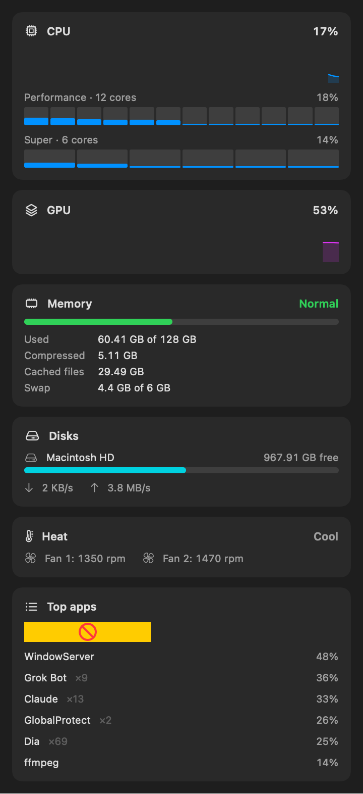

# StatBar

StatBar is a native macOS menu bar utility for the system stats that matter on a
personal M5 Max MacBook Pro used for video and motion work. It is a lean,
from-scratch take on the idea behind iStat Menus, and it leaves battery, power
and network to its siblings [PowerBar](https://github.com/erikrole/PowerBar) and
[NetBar](https://github.com/erikrole/NetBar).

- **Menu bar:** CPU percentage beside a gauge that turns yellow or red with memory pressure.
- **CPU:** total load with a two-minute history, and each core group (Super and
  Performance on M5) with per-core bars.
- **GPU:** device utilization with history.
- **Memory:** pressure first, then used, compressed, cached files and swap, using
  Activity Monitor's definition of Memory Used.
- **Disks:** free space on the startup disk and any local media drives (network
  shares are skipped so a slow NAS can't stall the menu), plus live read and write.
- **Heat:** macOS thermal state (whether the Mac is throttling) and fan speeds.
- **Top apps:** by CPU or memory, with helper processes counted as their app.

Everything is read through public, unprivileged interfaces (Mach host statistics,
sysctl, the IORegistry, read-only SMC fan keys and `ps`). There is no privileged
helper. CPU, GPU and memory sample every two seconds; disks, fans and the app list
are read only while the popover is open.



## Build and run

Requirements: macOS 14 or later, Xcode, and XcodeGen.

```sh
xcodegen generate
xcodebuild -project StatBar.xcodeproj -scheme StatBar -configuration Debug CODE_SIGNING_ALLOWED=NO build
open ~/Library/Developer/Xcode/DerivedData/StatBar-*/Build/Products/Debug/StatBar.app
```

`StatBar --report` samples for a few seconds and prints every reading;
`StatBar --snapshot file.png` renders the popover's cards to an image.

## Test

```sh
xcodebuild -project StatBar.xcodeproj -scheme StatBar -destination 'platform=macOS' CODE_SIGNING_ALLOWED=NO test
```

## License

StatBar is released under the MIT License.
